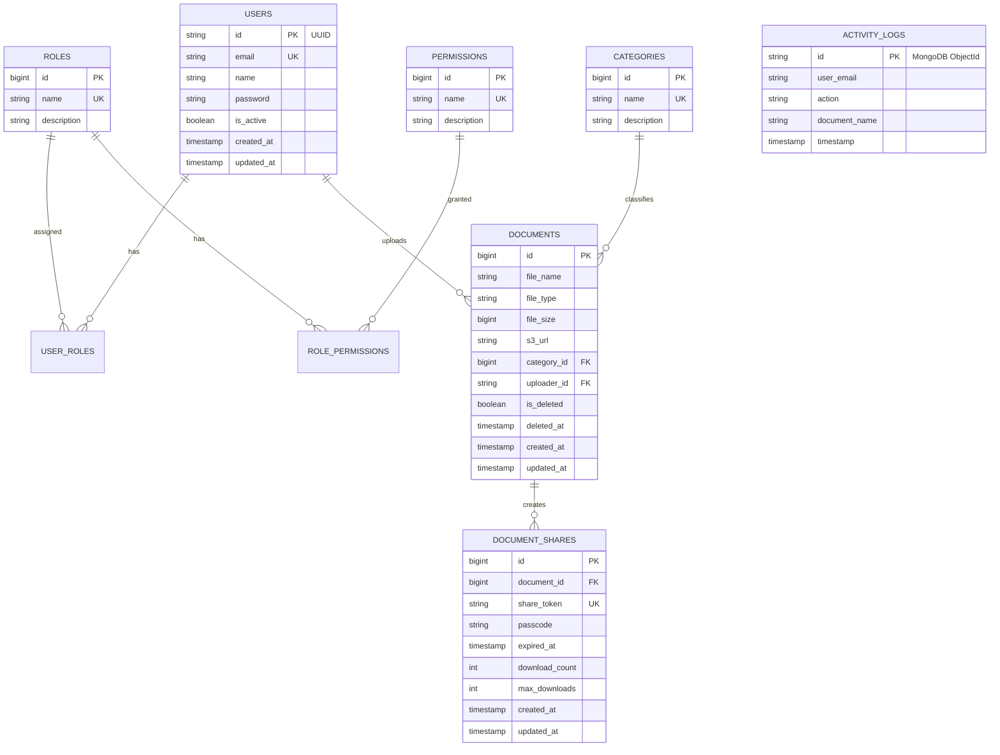
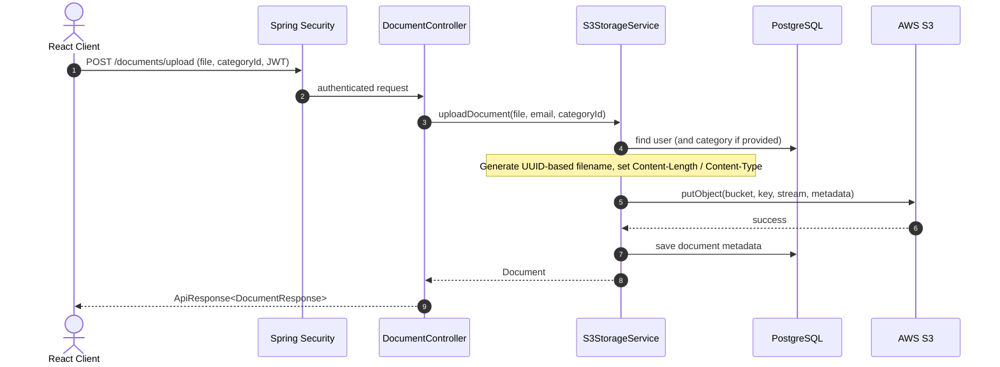

# Architecture Notes

Detailed design notes for Enterprise Document Hub. See the [README](./README.md) for an overview and quick start.

## Database Schema

PostgreSQL holds consistent, relational data. MongoDB holds audit logs.



## Authentication & Token Lifecycle

- Access tokens are JWTs signed with HS512; refresh tokens are stored in Redis and rotated on use.
- On logout, the access token is written to a Redis blacklist for its remaining time-to-live, so a replayed token is rejected until it would have expired anyway.
- Endpoint access is enforced with `@PreAuthorize` (for example, only `ADMIN` can manage categories, roles and users).
- Document visibility: public documents, documents the user uploaded, and documents of the user's own department.

## Upload Workflow



Upload goes through the application server (size limit 10 MB, formats: PDF, DOCX, PNG, JPEG). Download does not: the client receives a presigned URL and fetches the file directly from S3.

## Share Links

1. The owner creates a link with an optional passcode, expiry and maximum download count.
2. A guest calls `POST /shares/{token}/download`; the service validates passcode, expiry and download count.
3. On success the guest receives a presigned URL, and the owner gets a real-time WebSocket alert.
4. The owner can list links (with usage counts) and revoke any of them.

## Audit Logging

`ActivityLogAspect` intercepts `UPLOAD_DOCUMENT`, `DOWNLOAD_DOCUMENT` and `DELETE_DOCUMENT` and writes an `ActivityLog` document to MongoDB. It queries the document by ID so the log stores the actual file name rather than only an ID.

## Global Error Handling

A `@RestControllerAdvice` ([GlobalExceptionHandler.java](../backend/src/main/java/backend/example/backend/common/exception/GlobalExceptionHandler.java)) maps application exceptions, upload-size violations (HTTP 413, code 1014) and unexpected errors to a consistent `ApiResponse` JSON body, so stack traces never reach the client.

```json
{ "code": 1014, "message": "File upload size exceeds limit (Max: 10MB)!" }
```

## Cloud Configuration & Troubleshooting

Credentials are never hardcoded: `application.yml` reads `${ACCESS_KEY}`, `${SECRET_KEY}` and related values from the environment (see [application-example.yml](../backend/src/main/resources/application-example.yml)). In production, prefer an IAM role with `DefaultAWSCredentialsProviderChain` over static keys.

**S3 returns 403 Access Denied in development:**

1. **Region mismatch:** the bucket region must match `AWS_REGION`.
2. **IAM permissions:** the IAM user needs `s3:PutObject`, `s3:GetObject`, `s3:DeleteObject` on `arn:aws:s3:::<bucket>/*` and `s3:ListBucket` on `arn:aws:s3:::<bucket>`.
3. **Block Public Access:** keep it enabled and do not upload with public ACLs; use presigned URLs for reads.
4. **Check outside Spring:** run `aws configure` and `aws s3 ls s3://<bucket>`. If that fails, the problem is IAM, not the application.

**`NoSuchKey` / signature mismatch with special characters:** object keys containing spaces or Vietnamese characters must be URL-decoded consistently before signing and deleting.
