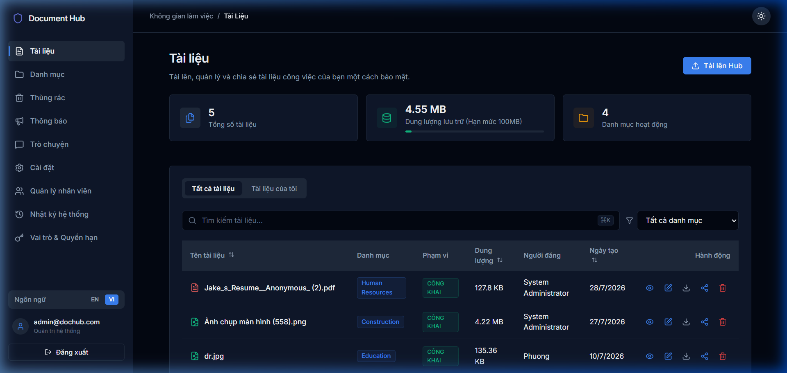
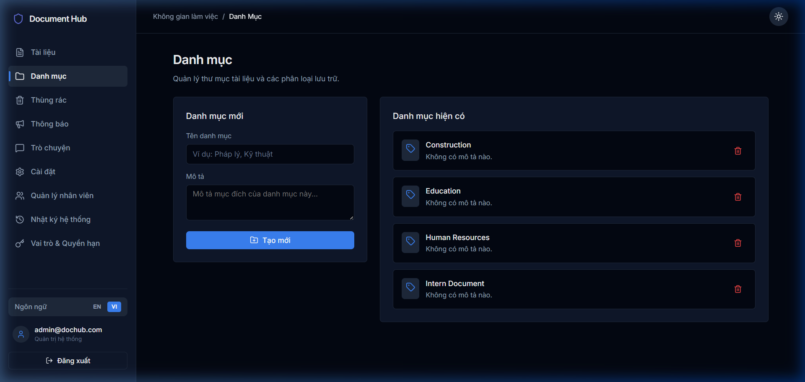
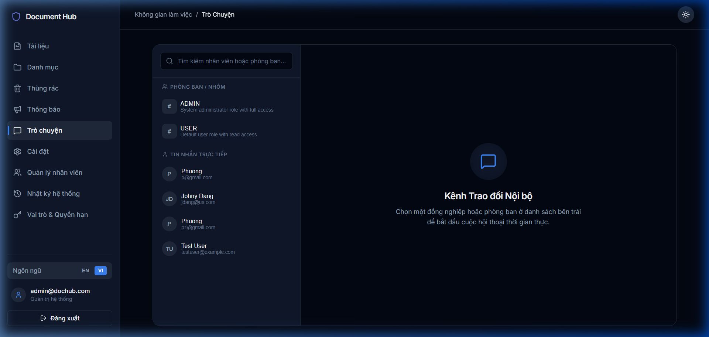
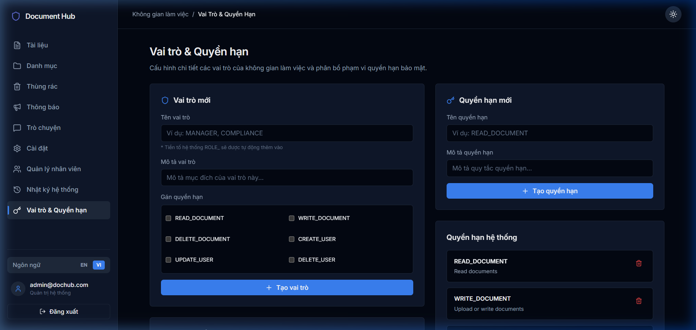
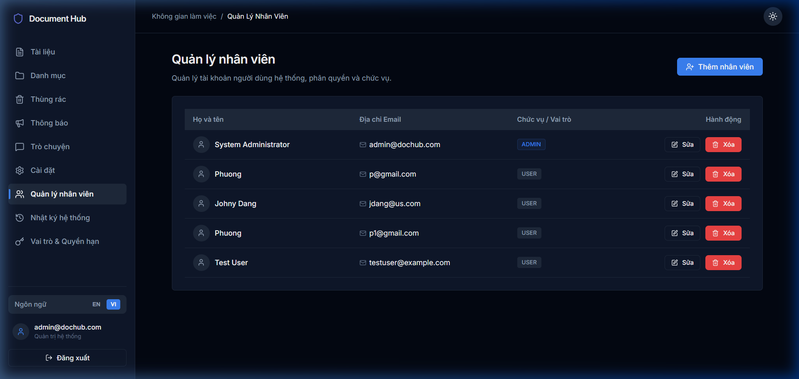
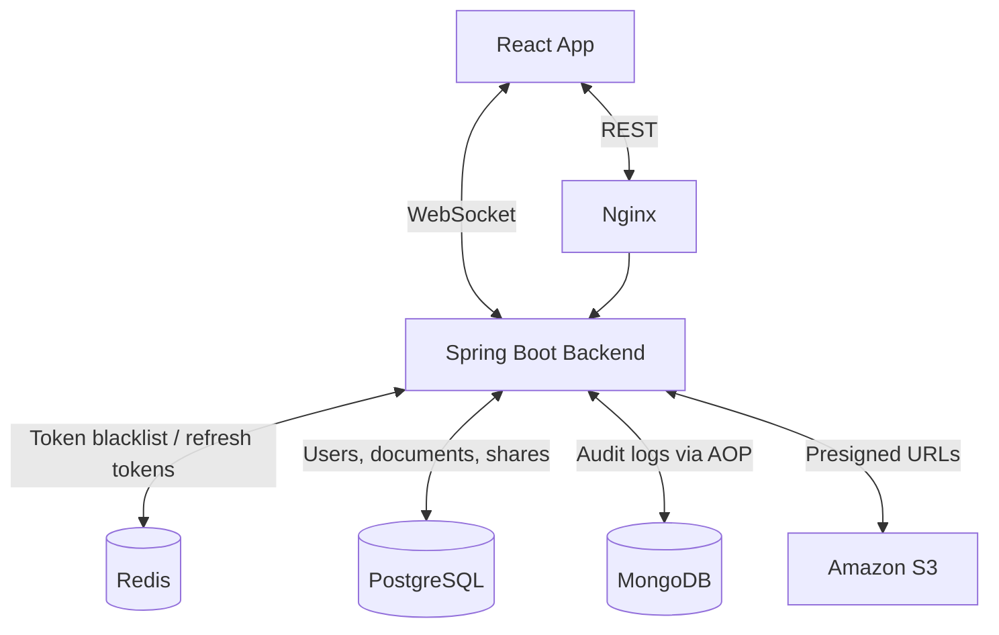

# Enterprise Document Hub

An internal document management and sharing system built with **Spring Boot 3**, **PostgreSQL**, **MongoDB**, **Redis** and **AWS S3**. Files live in a private S3 bucket and are served through time-limited presigned URLs, access is controlled by JWT + role/department-based RBAC, and share links support passcodes, expiry, and download limits.



<details>
<summary>More screenshots</summary>

|                                                |                                                                |
| ---------------------------------------------- | -------------------------------------------------------------- |
|       |                  |
|        |                              |
|  |  |
|            |             |

</details>

## Features

- **Secure storage:** files are private S3 objects; downloads use presigned URLs valid for 10 minutes, so the real object path is never exposed.
- **Authentication & RBAC:** stateless JWT (Spring Security OAuth2 Resource Server), `@PreAuthorize` on endpoints, and department-based document visibility (public, own, or own department).
- **Token lifecycle:** short-lived access tokens, refresh token rotation, and logout revocation through a Redis blacklist with TTL.
- **Share links:** unique token per link, optional passcode, expiry (1 hour / 1 day / 7 days / unlimited), maximum download count, and instant revocation. Guests can download without an account.
- **Real-time alerts:** document owners get a WebSocket notification when someone downloads through their share link. Department and direct-message chat is also built on WebSocket.
- **Trash bin:** soft delete, restore, and permanent delete (removes the PostgreSQL record and the S3 object).
- **Audit logging:** upload / download / delete actions are captured with Spring AOP and stored in MongoDB, keeping activity logs out of the transactional database.

## Engineering Highlights

| Problem                                                                | Decision                                                                                                             |
| ---------------------------------------------------------------------- | -------------------------------------------------------------------------------------------------------------------- |
| Stateless JWT cannot be invalidated on logout                          | Store the revoked access token in Redis until its remaining TTL expires; rotate refresh tokens                       |
| File traffic should not pass through the app server                    | Private bucket + presigned URLs for download                                                                         |
| Audit data has a different shape and write pattern than business data  | Spring AOP aspect writes `ActivityLog` documents to MongoDB, resolving the real document name instead of only its ID |
| S3 signature / `NoSuchKey` errors with spaces and Vietnamese filenames | URL-decode and normalize object keys; upload under `UUID_filename` to avoid collisions                               |
| Routing WebSocket messages to the right users                          | `WebSocketSessionManager` maps users to live sessions                                                                |
| Leaking internals through errors                                       | Central `@RestControllerAdvice` returns a consistent JSON error contract and hides stack traces                      |

## Architecture



ER diagram, upload sequence diagram, S3 troubleshooting, and error-handling notes: see [ARCHITECTURE.md](/ARCHITECTURE.md).

## Tech Stack

- **Backend:** Java 17, Spring Boot 3, Spring Data JPA, Spring Security (JWT), Spring AOP, Spring WebSocket, MapStruct, Lombok
- **Frontend:** React 19 (Vite), Context API, custom CSS (light/dark theme)
- **Data:** PostgreSQL, MongoDB, Redis
- **Cloud & Infra:** AWS S3, Docker, Docker Compose, Nginx

## Quick Start

**Prerequisites:** Java 17+, Node.js 18+, Docker, and an AWS account with a **private** S3 bucket.

```bash
# 1. Configure environment
cp .env.example .env        # fill in DB credentials, bucket name, AWS keys and region

# 2. Start PostgreSQL, MongoDB, Redis
docker compose up -d

# 3. Run the backend (http://localhost:8080)
cd backend
./mvnw spring-boot:run      # Windows: mvnw.cmd spring-boot:run

# 4. Run the frontend (http://localhost:5173)
cd frontend
npm install
npm run dev
```

Default ports: PostgreSQL `5433`, MongoDB `27017`, Redis `6380`. Seed users, roles and permissions are created on startup by `DataInitializer.java` (see the file for the default accounts).

> `DDL_AUTO=update` and `SHOW_SQL=true` in `.env` are for local development only. Never commit `.env`.

## Main API Endpoints

| Module    | Method | Endpoint                    | Access        | Description                                 |
| --------- | ------ | --------------------------- | ------------- | ------------------------------------------- |
| Auth      | POST   | `/auth/login`               | Public        | Log in, receive access + refresh tokens     |
|           | POST   | `/auth/refresh`             | Public        | Rotate tokens                               |
|           | POST   | `/auth/logout`              | Authenticated | Blacklist access token in Redis             |
| Documents | POST   | `/documents/upload`         | Authenticated | Upload to S3                                |
|           | GET    | `/documents`                | Authenticated | Paginated list                              |
|           | GET    | `/documents/{id}/download`  | Authenticated | 10-minute presigned URL                     |
|           | DELETE | `/documents/{id}`           | Authenticated | Soft delete                                 |
| Trash     | PUT    | `/documents/{id}/restore`   | Authenticated | Restore                                     |
|           | DELETE | `/documents/{id}/permanent` | Authenticated | Delete from DB and S3                       |
| Share     | POST   | `/documents/{id}/share`     | Authenticated | Create link (passcode, expiry, limit)       |
|           | DELETE | `/shares/{token}`           | Authenticated | Revoke link                                 |
|           | POST   | `/shares/{token}/download`  | Public        | Download after passcode/expiry/limit checks |
| Admin     | GET    | `/users`                    | `ADMIN`       | List users                                  |
|           | POST   | `/categories`               | `ADMIN`       | Create category                             |

## Project Structure

```text
document-hub/
├── docker-compose.yml
├── backend/src/main/java/.../
│   ├── common/     # base entities, exceptions, response format
│   ├── config/     # security, S3, JWT, WebSocket, data seeding
│   └── modules/    # auth, user, document (+ share), log (AOP audit)
└── frontend/src/   # context, pages, services (Axios interceptor)
```

## Roadmap

- [ ] Integration tests with Testcontainers (auth flow, share-link rules)
- [ ] GitHub Actions CI: build and test on every push
- [ ] Rate limiting on the public share-download endpoint
- [ ] Atomic enforcement of `max_downloads` under concurrent downloads
- [ ] Swagger / OpenAPI documentation
