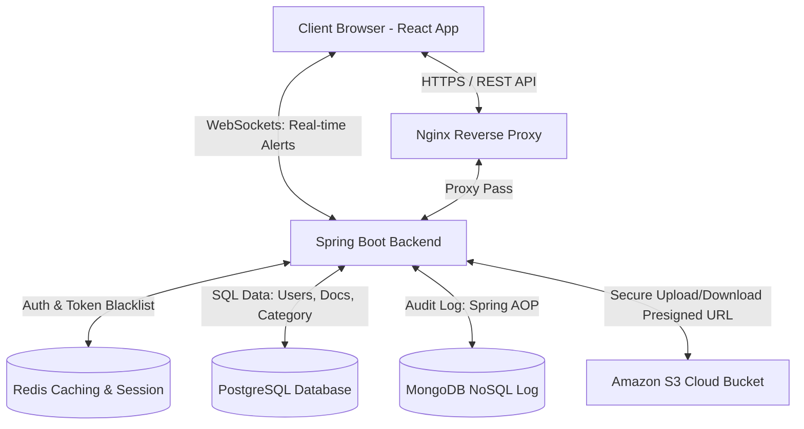
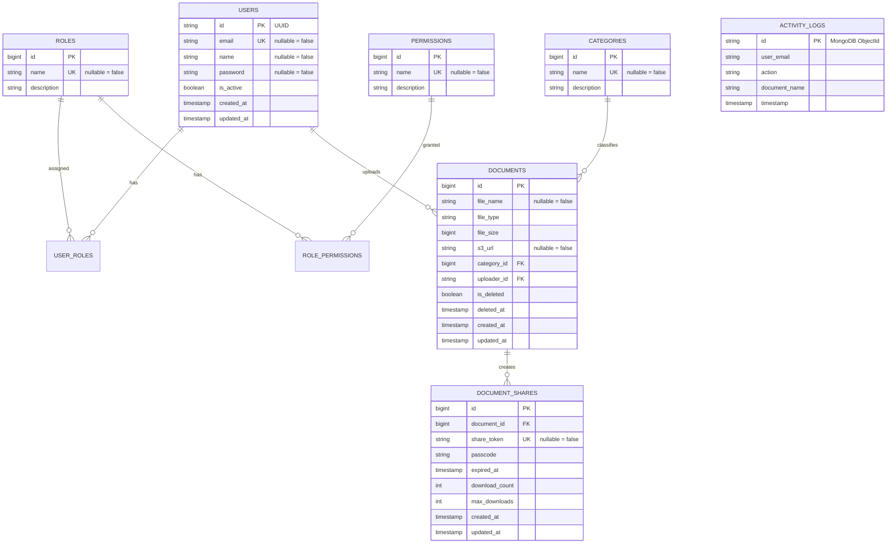
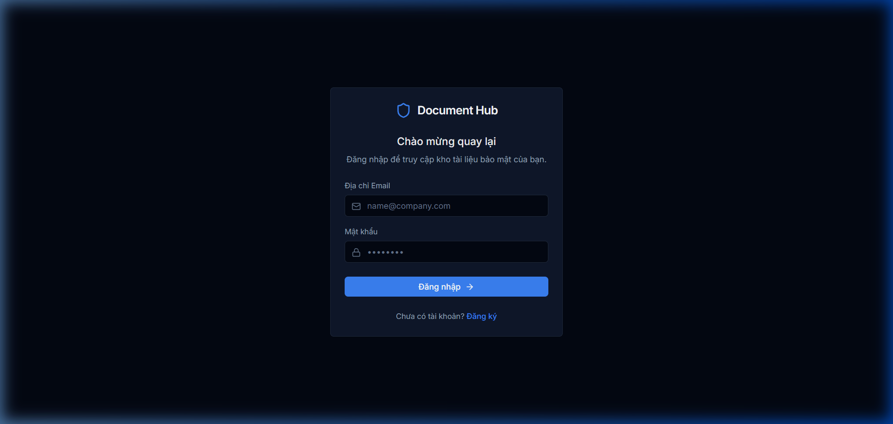
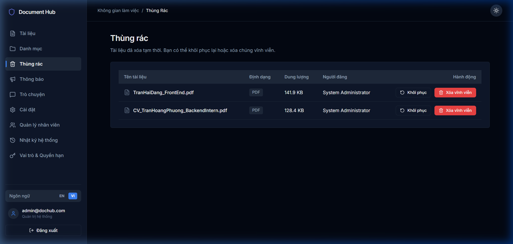
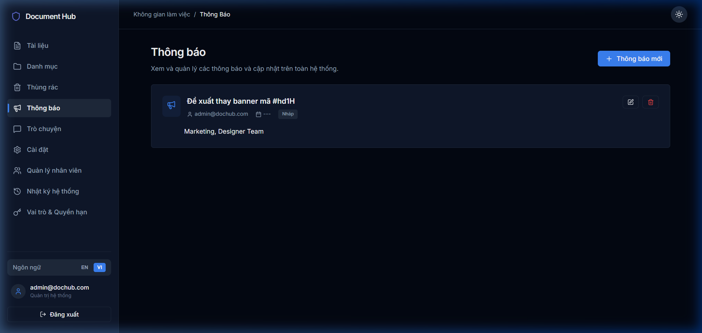
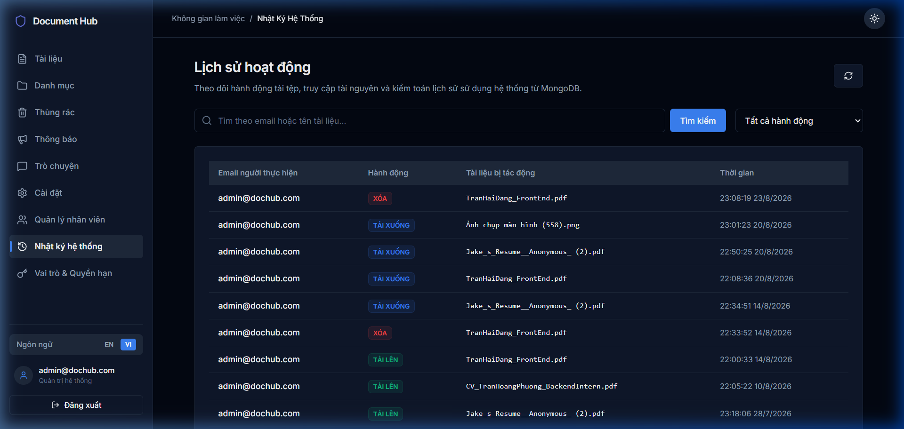
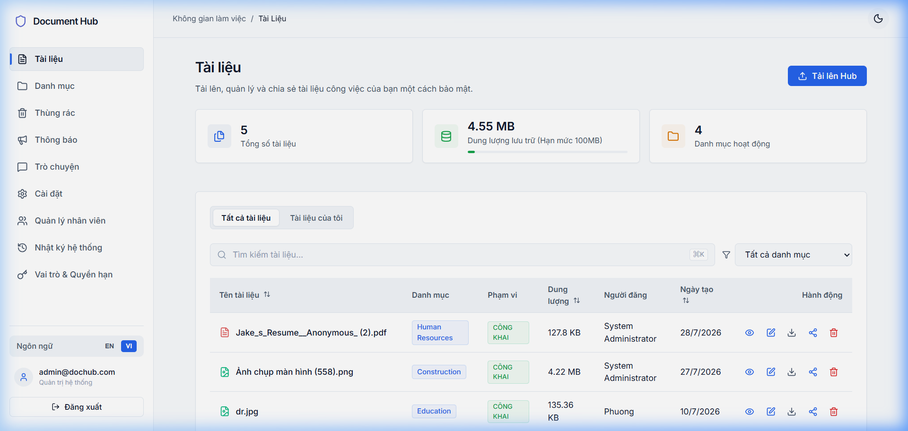
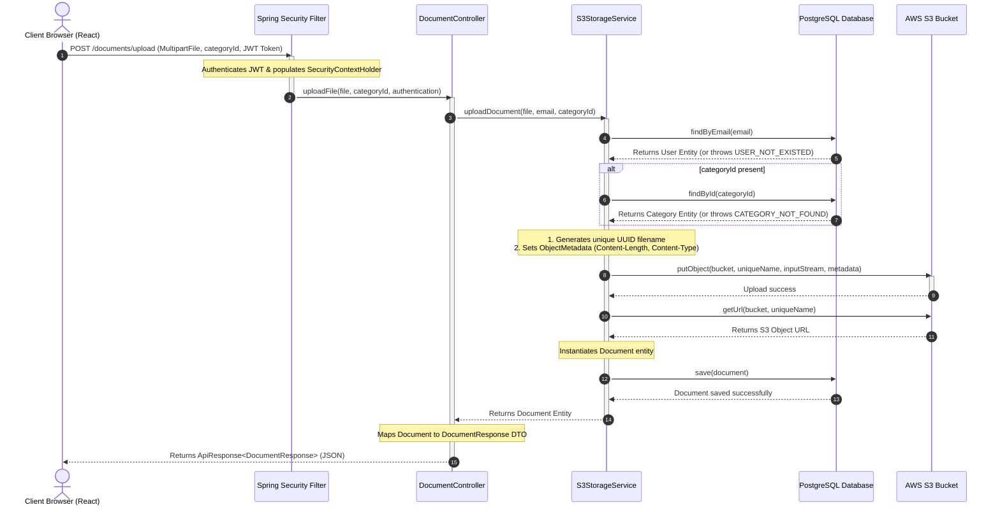

# Enterprise Document Hub

Enterprise Document Hub is a professional, enterprise-grade internal document management and sharing system. The system is designed with a hybrid database architecture combining SQL (PostgreSQL) and NoSQL (MongoDB), integrated with AWS S3 cloud storage, a Redis caching/blacklist mechanism, real-time communication via WebSockets, and a modern, minimalist user interface supporting both light and dark modes.

The project is designed to address real-world enterprise requirements:
1. Secure and Decentralized Document Storage: Direct integration with AWS S3 for binary storage, masking actual S3 URLs using the Presigned URL mechanism.
2. Role-Based Access Control (RBAC): Fine-grained user authorization down to each API endpoint using JWT tokens and Spring Security.
3. High-Performance Audit Logging: Utilizes Spring AOP (Aspect-Oriented Programming) to log user interactions asynchronously into MongoDB, minimizing primary database load.
4. Advanced File Sharing: Support for generating passcode-protected public file download links with expiration times, download limits, and flexible link revocation.
5. Real-Time Notifications: Automated WebSocket-based alerts sent to document owners immediately when someone downloads a file through their shared link.
6. Trash Bin (Soft Delete & Restore): Supports temporary deletion, recovery, and permanent deletion of files from both the database and AWS S3.

---

## Tech Stack & System Architecture

### 1. Tech Stack
* Backend: Java 17, Spring Boot 3.x, Spring Data JPA, Spring Security (OAuth2 Resource Server JWT), Spring AOP (AspectJ), Spring WebSockets, MapStruct, Lombok.
* Frontend: React 19 (Vite), Custom CSS (Vercel-like dark UI / Light Mode compatible), Lucide Icons, Context API.
* Databases & Caching:
    * PostgreSQL (Relational): Stores highly consistent, structured data including Users, Roles, Permissions, Categories, Documents, and Document Shares.
    * MongoDB (NoSQL): Stores unstructured activity logs (`ActivityLog`), ensuring high-speed write performance and scalability.
    * Redis: Manages JWT blacklist during logout and stores Refresh Tokens for Token Rotation.
* Cloud Infrastructure: AWS S3 (Simple Storage Service) for secure file storage, preventing server disk space bloat.
* Containerization & Proxy: Docker, Docker Compose, Nginx.

---

### 2. System Architecture Diagram

The diagram below displays the system components and data flows:



---

## Database Schema

The database design implements a hybrid structure combining PostgreSQL and MongoDB:



---

## Core Business Features

### 1. Authentication & Authorization (RBAC)
* Stateless Authentication: Uses JSON Web Tokens (JWT) signed with the HS512 algorithm.
* Redis Token Blacklisting & Refresh Rotation:
    * Supports short-lived Access Tokens and long-lived Refresh Tokens.
    * When a user logs out, the active Access Token is added to a Redis-based blacklist for its remaining time-to-live (TTL) to protect against Replay Attacks.
* Role & Permission Based Access Control (RBAC): Secured using `@PreAuthorize` annotations at the Controller layer. For example, only users with the `ADMIN` role can manage categories, roles, and users.

### 2. Document Management & Access Control
* Private Cloud Storage: Uploaded files are sent directly to AWS S3 as private objects, meaning they cannot be accessed directly via public HTTP URLs.
* S3 Presigned URLs: When a user requests to download a file, the system generates a temporary access URL valid for a maximum of 10 minutes. This ensures document security and hides the actual S3 object path.
* Category Organization: Organizes files by category. Users can change the category of files through the edit dialog on the UI.
* Department-based Access Control: Supports restricting document visibility upon upload (Public or restricted to departments like `IT`, `ACCOUNTING`). Regular department members can only view public documents, documents they uploaded, or documents belonging to their own department.
* "My Documents" View: Real-time filter on the Dashboard to quickly view files uploaded by the logged-in user.

### 3. Trash Bin (Soft Delete & Restore)
* Soft Delete: Hides documents instead of deleting them permanently. The system marks `isDeleted = true` and records the deletion time `deletedAt`, filtering them out from the main dashboard.
* Restore: Recovers soft-deleted documents back to the main dashboard with a single click.
* Hard Delete: Permanently deletes the database record in PostgreSQL and invokes the AWS S3 SDK to delete the binary object from the S3 bucket, releasing cloud storage space.

### 4. Advanced Share Links
* Unique Share Tokens: Share links are associated with a unique, randomly generated UUID/Token string.
* Advanced Security Configurations:
    * Passcode Protection: Guests must enter a correct passcode set by the owner to access and download the file.
    * Link Expiration: Supports quick selection of link expiration time (`+1 hour`, `+1 day`, `+7 days`, `Unlimited`) to enhance UX.
    * Max Downloads Limit: The link automatically deactivates when the configured download limit is reached.
* View & Revoke Links: The share management panel displays all active shared links, including download count, expiration date, passcode, and allows instant link revocation (deletion).
* Guest File Download: Allows users without an account to download shared documents via the `/shares/{token}/download` endpoint after passing all verification rules.

### 5. WebSockets Chat & Alerts
* Real-time Chat: Integrated instant messaging interface supporting:
    * 1-to-1 direct messaging between colleagues.
    * Group chat rooms separated by Department (IT, Accounting, etc.), routing messages automatically based on user roles.
    * Robust connection handling with automatic reconnects upon disconnection without page refresh.
* Download Alerts: When a guest downloads a file via a public share link, the backend identifies the document owner and pushes a real-time notification via WebSockets. The frontend intercepts this event to display a smooth slide-in toast alert.

### 6. System Monitoring (AOP Audit Logging)
* Leverages Spring AOP (Aspect-Oriented Programming) via `ActivityLogAspect` to intercept and log critical operations (`UPLOAD_DOCUMENT`, `DOWNLOAD_DOCUMENT`, `DELETE_DOCUMENT`).
* Uses standard `JoinPoint` configurations and dynamic entity querying to capture the actual document name instead of just the database ID in the logs, avoiding server compilation issues or parameter optimization conflicts.
* Audit logs are stored asynchronously in MongoDB to prevent database locks and minimize the write load on the primary PostgreSQL database.

### 7. Refined User Experience (UX/UI Polish)
* Custom Confirm Modal Context: Eliminates raw browser `confirm()` and `alert()` calls. Uses a custom confirmation modal powered by React Context, styled with a modern glassmorphic design and smooth transitions (`scale-up`, `fade-in`).
* Light / Dark Theme Switcher: Instant toggling of UI theme saved directly to `localStorage` to persist user preference.

---

## Application Screenshots

Here are the screenshots of the primary user interfaces of the Enterprise Document Hub system:

### 1. Authentication
* **Login Page:**
  

### 2. Workspace Tabs
* **Dashboard (Documents Management):**
  
  
* **Categories:**
  

* **Trash Bin (Soft Delete Management):**
  

### 3. Collaboration & Communication
* **Announcements Board:**
  

* **Real-time Chat (Department & Direct Message):**
  

### 4. Admin Management Dashboard
* **Staff Directory & Management:**
  

* **System Audit Logs:**
  

* **Roles & Permissions Configurator:**
  

### 5. Personalization
* **Dashboard (Light Mode):**
  

---

## Project Structure

```text
document-hub/
├── docker-compose.yml          # Manages PostgreSQL, MongoDB, Redis, App, Nginx
├── .env                        # Development environment security configurations
├── backend/                    # --- BACKEND SOURCE CODE (SPRING BOOT) ---
│   ├── src/main/java/backend/example/backend/
│   │   ├── common/             # Base entities, exception handlers, standard response format, GlobalExceptionHandler
│   │   ├── config/             # Security, AWS S3, JWT, WebSockets, Database Initialization
│   │   └── modules/            # Business modules
│   │       ├── auth/           # Login, registration, token refresh, and blacklist (Redis)
│   │       ├── user/           # User management, Roles, Permissions (RBAC)
│   │       ├── document/       # CRUD Document, Category, S3 Storage Service, share link management
│   │       └── log/            # AOP Activity Logging (MongoDB)
│   ├── src/main/resources/
│   │   └── application.yml     # Database, port, JWT, and AWS configuration
│   └── pom.xml                 # Maven dependency & build configuration
├── frontend/                   # --- FRONTEND SOURCE CODE (REACT JS) ---
│   ├── src/
│   │   ├── assets/             # Logos, icons, fonts, and images
│   │   ├── context/            # AuthContext (session) & ConfirmContext (custom dialogs)
│   │   ├── pages/              # UI Pages (Auth, Dashboard, Category, Trash, ShareView)
│   │   ├── services/           # Axios Interceptor for API calls (auto JWT injection)
│   │   ├── App.jsx             # Router navigation & Theme Provider
│   │   ├── index.css           # Design system and custom CSS (Vercel-like Dark/Light mode styling)
│   │   └── main.jsx            # React application entry point
│   └── package.json            # Frontend dependencies and npm scripts
```

---

## Installation & Quick Start Guide

### 1. Prerequisites
* Java 17 or 21 installed.
* Node.js (v18+) and npm installed.
* Docker & Docker Compose installed.
* Active AWS Account with a private S3 Bucket configured.

### 2. Configure Environment Variables (`.env`)
Create a `.env` file in the root directory (`/document-hub/.env`) with the following variables:
```env
# --- DATABASE CREDENTIALS ---
DB_USER=postgres_admin
DB_PASSWORD=super_secret_pg_password
DB_NAME=document_hub_db

# --- SPRING BOOT ENVIRONMENT ---
PORT=8080
DB_URL=jdbc:postgresql://localhost:5433/document_hub_db
DB_DRIVER_CLASS=org.postgresql.Driver
DDL_AUTO=update
SHOW_SQL=true
FORMAT_SQL=true
DATABASE_PLATFORM=org.hibernate.dialect.PostgreSQLDialect
MONGO_URL=mongodb://localhost:27017/document_hub_logs

# --- AWS S3 CREDENTIALS ---
BUCKET_NAME=your_bucket_name
ACCESS_KEY=your_aws_access_key
SECRET_KEY=your_aws_secret_key
AWS_REGION=your_s3_region (e.g., ap-southeast-1)
```

Note: Do not commit the `.env` file to public repositories like GitHub. It contains sensitive credentials to your database and cloud resources.

### 3. Spin Up Database Infrastructure
Run the following command in the root directory to start PostgreSQL, MongoDB, and Redis:
```bash
docker compose up -d
```
Verify the running containers with `docker ps` to ensure:
* PostgreSQL is running on port `5433` (mapped from container port `5432`).
* MongoDB is running on port `27017`.
* Redis is running on port `6380` (mapped from container port `6379`).

### 4. Run the Backend (Spring Boot)
Open a new terminal window, navigate to the `backend` directory, and execute:
```bash
cd backend
./mvnw.cmd spring-boot:run
```
* The backend server will run at: `http://localhost:8080`
* Initial seed data (Admin/User accounts and sample permissions) is automatically loaded via `DataInitializer.java` upon startup.

### 5. Run the Frontend (React + Vite)
Open a new terminal window, navigate to the `frontend` directory, and execute:
```bash
cd frontend
npm install
npm run dev
```
* The React application will run at: `http://localhost:5173`

---

## Main API Endpoints

| Module | Method | Endpoint | Authorization | Description |
| :--- | :--- | :--- | :--- | :--- |
| **Auth** | `POST` | `/auth/login` | Public | Logs in user, returns JWT Token |
| | `POST` | `/auth/refresh` | Public | Refreshes Access Token via Refresh Token |
| | `POST` | `/auth/logout` | Authenticated | Logs out user, blacklists token in Redis |
| **User** | `POST` | `/users/create` | Public | Registers a new account |
| | `GET` | `/users/my-info` | Authenticated | Gets profile details of logged-in user |
| | `GET` | `/users` | `Role: ADMIN` | Lists all registered users |
| **Doc** | `POST` | `/documents/upload` | Authenticated | Uploads file directly to AWS S3 |
| | `GET` | `/documents` | Authenticated | Retrieves documents (with pagination) |
| | `GET` | `/documents/{id}/download` | Authenticated | Generates a 10-minute S3 presigned URL |
| | `DELETE` | `/documents/{id}` | Authenticated | Soft deletes a document (moves to trash) |
| **Trash** | `GET` | `/documents/trash` | Authenticated | Lists soft-deleted documents |
| | `PUT` | `/documents/{id}/restore` | Authenticated | Restores a soft-deleted document |
| | `DELETE` | `/documents/{id}/permanent` | Authenticated | Hard deletes document from DB & S3 |
| **Category** | `POST` | `/categories` | `Role: ADMIN` | Creates a new category |
| | `GET` | `/categories` | Authenticated | Lists all categories |
| **Share** | `POST` | `/documents/{id}/share` | Authenticated | Creates a shared link (passcode, expiration, etc.) |
| | `GET` | `/documents/{id}/shares` | Authenticated | Lists all active share links for a document |
| | `DELETE` | `/shares/{token}` | Authenticated | Revokes (deletes) a share link |
| | `POST` | `/shares/{token}/download` | Public | Downloads shared file (validating passcode & expiry) |

---

## Security & Resume Highlights

Key technical and security milestones built into this project:
1. Stateless Security Design: Managed entirely using JWTs, eliminating server memory consumption for session data, which makes the server highly scalable.
2. Preventing S3 Link Leaks: Keeps the bucket entirely private. Securely serves files via temporary, time-limited Amazon S3 Presigned URLs.
3. Token Revocation with Redis: Solves the stateless JWT logout problem by storing revoked tokens in Redis until their expiration date.
4. Log Database Isolation: Prevents PostgreSQL disk write contention (I/O bottlenecks) by logging user activity asynchronously into MongoDB using Spring AOP.
5. Robust Trash Lifecycle: Combines Soft Delete to protect against accidental user deletion and Hard Delete to release S3 storage.
6. Resolving S3 Signature Mismatches on Special Characters: Handles URL-decoding for S3 object keys dynamically to prevent `NoSuchKey` and Signature Mismatch exceptions when handling filenames with spaces or Vietnamese characters.
7. WebSocket Session Management: Manages WebSocket sessions dynamically with `WebSocketSessionManager` to route alerts and messages accurately to user connections.
8. Global Exception Handling: Centralizes exception catching (`@RestControllerAdvice`) to hide internal stack traces from clients and return structured JSON responses.

---

## Technical Deep-Dive: Workflows, Cloud Configurations & Troubleshooting

### 1. File Upload Workflow (Sequence Diagram)



#### Process Breakdown:
1. **Request Sent:** React App sends a `multipart/form-data` POST request to `/documents/upload` with the binary file and `categoryId`. The request contains the `Authorization: Bearer <token>` header.
2. **Security Interception:** Spring Security validates the JWT, initializes the authentication object in the context, and routes the request.
3. **Controller Handling:** `DocumentController` extracts the file from `@RequestParam("file")`, resolves the user's email via `Authentication.getName()`, and invokes `S3StorageService.uploadDocument()`.
4. **Service Logic:**
    * **Validation:** Verifies the user and category exist, throwing custom `AppException` if missing.
    * **Filename Safety:** Renames the file to `UUID_filename` to avoid S3 collisions.
    * **Streaming to S3:** Populates `ObjectMetadata` with `Content-Length` and `Content-Type` for efficient S3 chunked transfer. Uploads using `amazonS3.putObject()` and retrieves its reference URL.
    * **Database Log:** Saves a metadata record of the document mapping S3 keys, sizes, uploader, and category to PostgreSQL.
5. **Response Return:** The entity is mapped to a DTO and returned as a JSON `ApiResponse`.

---

### 2. Cloud Configuration & Access Troubleshooting

To prevent credentials from leaking, the project avoids hardcoded values and utilizes standard environment variable interpolation.

#### Access Protection:
* Placeholders are defined in application configurations (e.g., `aws.s3.access-key: ${ACCESS_KEY}`). Refer to [application-example.yml](file:///d:/DH/HOCKI2_25_26/JAVA/document-hub/backend/src/main/resources/application-example.yml).
* Values are injected at runtime via the `.env` file (which is ignored by Git).
* *Production Recommendation:* Assign an IAM Instance Profile or Service Account Role to the runtime machine, using `DefaultAWSCredentialsProviderChain` instead of hardcoded static keys.

#### Resolving AWS S3 403 Access Denied Errors in Dev:
1. **Region Mismatch:** Ensure the bucket region in the AWS console matches `AWS_REGION` (e.g., `ap-southeast-2`).
2. **IAM Permissions:** Verify that the IAM user keys configured have `s3:PutObject`, `s3:GetObject`, and `s3:DeleteObject` for `arn:aws:s3:::your-bucket/*` and `s3:ListBucket` for `arn:aws:s3:::your-bucket`.
3. **Block Public Access Conflict:** Do not upload files with public read ACLs if S3 "Block all public access" is enabled. Keep the bucket private and generate Presigned URLs for retrieval instead.
4. **CLI Validation:** Run `aws configure` with the dev credentials and verify access via `aws s3 ls s3://your-bucket-name`. If this fails, the issue lies in AWS IAM Policies, not Spring Boot.

---

### 3. Global Exception Handling

The server prevents stack trace leaks and maintains a clean contract with the frontend client using a `@RestControllerAdvice`.

#### Exception Handler Configuration:
We catch specific validation errors and wrap them in custom formatted `ApiResponse` payloads. You can see how this works in [GlobalExceptionHandler.java](file:///d:/DH/HOCKI2_25_26/JAVA/document-hub/backend/src/main/java/backend/example/backend/common/exception/GlobalExceptionHandler.java):

```java
package backend.example.backend.common.exception;

import backend.example.backend.common.response.ApiResponse;
import org.springframework.http.HttpStatus;
import org.springframework.http.ResponseEntity;
import org.springframework.web.bind.annotation.ExceptionHandler;
import org.springframework.web.bind.annotation.RestControllerAdvice;
import org.springframework.web.multipart.MaxUploadSizeExceededException;

@RestControllerAdvice
public class GlobalExceptionHandler {

    // 1. Handles application exceptions (e.g., invalid file format)
    @ExceptionHandler(value = AppException.class)
    public ResponseEntity<ApiResponse<?>> handlingAppException(AppException exception) {
        ErrorCode errorCode = exception.getErrorCode();
        ApiResponse<?> apiResponse = ApiResponse.builder()
                .code(errorCode.getCode())
                .message(errorCode.getMessage())
                .build();
        return ResponseEntity.status(errorCode.getStatusCode()).body(apiResponse);
    }

    // 2. Handles file size limit violations
    @ExceptionHandler(value = MaxUploadSizeExceededException.class)
    public ResponseEntity<ApiResponse<?>> handlingMaxUploadSizeExceededException(MaxUploadSizeExceededException exception) {
        ApiResponse<?> apiResponse = ApiResponse.builder()
                .code(1014)
                .message("File upload size exceeds limit (Max: 10MB)!")
                .build();
        return ResponseEntity.status(HttpStatus.PAYLOAD_TOO_LARGE).body(apiResponse);
    }

    // 3. Fallback for unhandled exceptions to prevent stack trace leaks
    @ExceptionHandler(value = Exception.class)
    public ResponseEntity<ApiResponse<?>> handlingRuntimeException(Exception exception) {
        ApiResponse<?> apiResponse = ApiResponse.builder()
                .code(ErrorCode.UNCATEGORIZED_EXCEPTION.getCode())
                .message(ErrorCode.UNCATEGORIZED_EXCEPTION.getMessage())
                .build();
        return ResponseEntity.status(ErrorCode.UNCATEGORIZED_EXCEPTION.getStatusCode()).body(apiResponse);
    }
}
```

#### Sample JSON Responses:
* **Max File Size Limit Exceeded (HTTP Status 413):**
  ```json
  {
    "code": 1014,
    "message": "File upload size exceeds limit (Max: 10MB)!"
  }
  ```
* **Invalid File Format (HTTP Status 400):**
  ```json
  {
    "code": 1013,
    "message": "Invalid file format! Only PDF, DOCX, PNG, and JPEG are supported."
  }
  ```
